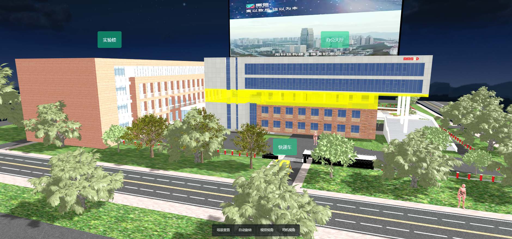
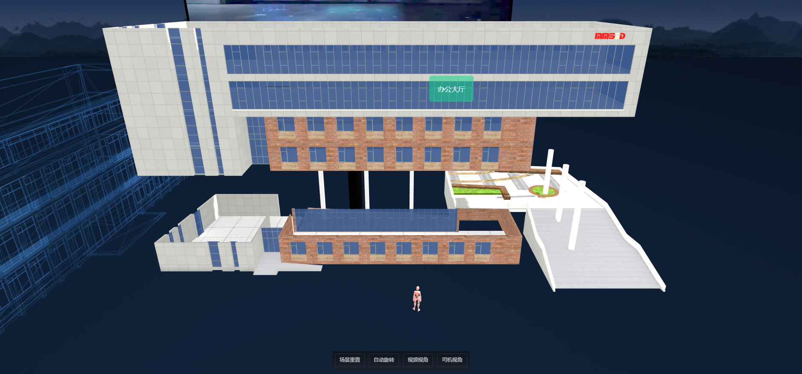

# threejs-park 智慧园区

[](LICENSE)
[](https://github.com/zenitlab/smartPark-3D/stargazers)
[](https://github.com/zenitlab/smartPark-3D/commits)


基于 **Three.js** 的智慧园区 3D 可视化系统，将园区建筑、车辆、绿化与设备以三维场景呈现，并提供楼层拆解、轨迹巡游、视频投放、视角切换等交互能力。

## 一、预览





## 二、技术栈

- **Vue 3.2** —— 视图层框架（`<script setup>` / 选项式 API）
- **Three.js 0.146** —— WebGL 三维渲染引擎
- **Vite 3.2** —— 开发与构建工具
- **GSAP 3** —— 补间动画（相机运镜、楼层升降、便签跳动等）
- **Sass** —— 样式预处理

## 三、功能特性

1. **楼层分体动画展示** —— 鼠标拾取办公大厅，逐层升起拆解，未选中楼层半透明虚化
2. **自动旋转与场景漫游** —— 一键开启/停止相机自动环绕，支持轨道控制器自由浏览
3. **嵌入 MP4 视频播放** —— 通过 `VideoTexture` 将视频实时投放到园区广告牌
4. **小车按轨迹行驶** —— 快递车沿 `CatmullRomCurve3` 闭合样条曲线循环行驶，途经停车场自动开启栏杆
5. **一键切换至小车行驶视角** —— 相机锁定车辆，跟随其行进方向第一视角巡游
6. **弹窗便签跟随小车移动** —— CSS2D 标签实时贴合车辆包围盒，随车移动
7. **更多细节** —— 加载进度条、停车场栏杆开合、无人机巡航、树木风动、人物行走、场景一键重置

## 四、模块架构

核心三维能力封装于 `src/components/three/modules/`，按职责拆分为可复用模块：

| 模块 | 职责 |
| --- | --- |
| `Viewer` | 场景初始化：渲染器、相机、场景、轨道控制器、CSS2D/CSS3D 渲染器与全局动画循环 |
| `ModelLoder` | 模型加载器，支持 GLTF / GLB / FBX，内置 DRACO 解压 |
| `DsModel` | 模型功能封装：阴影开关、包围盒、动画播放、克隆、拆分等 |
| `Lights` | 灯光管理：环境光 / 平行光 / 聚光灯 / 点光源 / 矩形面光源 |
| `SkyBoxs` | 天空盒与雾化效果 |
| `Weather` / `WeatherControl` | 天气控制 |
| `AnimatedTracks` | 模型骨骼/关键帧动画 |
| `MouseEvent` | 鼠标射线拾取事件 |
| `Labels` | CSS2D 场景标签 |
| `PathLine` | 路径线绘制 |
| `Floors` | 反射地板（`Reflector`） |
| `EffectComposer` | 后期处理 |

## 五、目录结构

```
smartPark-3D/
├── public/                     # 静态资源：模型(glb/gltf)、贴图、视频、DRACO 解码器
├── src/
│   ├── App.vue                 # 根组件，挂载 Threecity 场景
│   ├── main.js                 # 入口
│   └── components/three/
│       ├── Threecity.vue       # 主场景：园区搭建与交互逻辑
│       ├── modules/            # Three.js 功能模块（见上表）
│       └── shaders/            # 自定义着色器
├── index.html
├── vite.config.js
└── package.json
```

## 六、快速开始

> 环境要求：Node.js 14+（推荐 16+）

1. 安装依赖

```bash
yarn        # 或 npm install
```

2. 启动开发服务器

```bash
yarn dev    # 或 npm run dev
```

3. 构建生产包

```bash
yarn build  # 或 npm run build
```

4. 本地预览构建产物

```bash
yarn preview # 或 npm run preview
```

启动后浏览器访问终端提示的本地地址（默认 `http://localhost:5173`），等待模型加载进度条完成即可进入园区场景。

## 七、许可证

[MIT](LICENSE) License © 2022 cyl
