# WebGL三维引擎

#### 介绍
本三维引擎是基于Three.js进行二次开发，可用于数字孪生系统的开发，支持加载gltf格式的三维模型，提供模型的基础操作包括对象选择、移动，缩放、旋转，相机的移动等功能，可以满足基础的数字孪生平台的开发，也欢迎大家多交流

#### 功能展示
 

#### 软件架构
基于Three.js进行二次开发，针对三维模型的操作，提供相应的操作接口。

#### 基础功能说明
以设备数字孪生场景为例，三维引擎提供以下功能，类似的功能也可以用于工厂，园区的可视化展示：  

1.平移：鼠标右键并保持，移动鼠标即可平移模型。  

2.旋转：鼠标左键并保持，移动鼠标即可旋转模型。  

3.缩放-缩小：鼠标滚轮朝后滚动或者按下鼠标中键并向后拖动鼠标即可实现缩小。  

4.缩放-放大：鼠标滚轮朝前滚动或者按下鼠标中键并向前拖动鼠标即可实现放大。  

5.选中：点击模型区域可进行选中。  

6.取消选中：点击模型以外区域即可取消选中。  

7.结构目录树：结构目录树是设备各零部件的检索目录，各零部件的命名可以按照现场生产需求和运维习惯进行编辑，保持日常运维中和其它系统的命名统一。
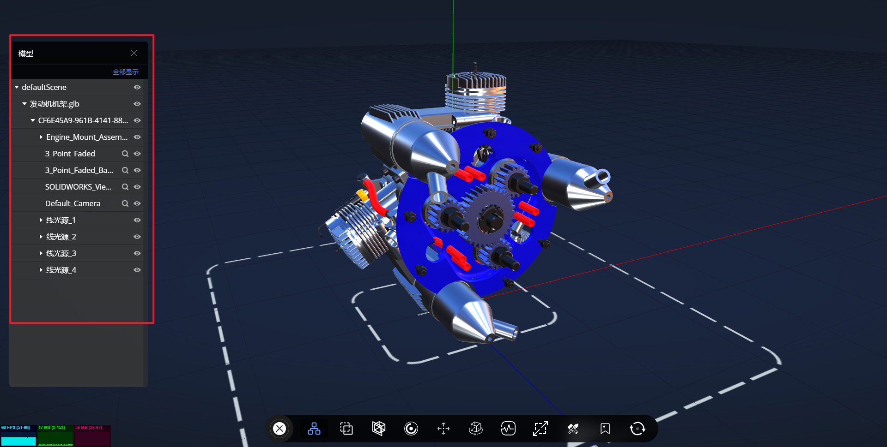  

8.显示/隐藏功能：对设备三维模型的零部件选中后进行显示/隐藏操作，该功能在目录树和工具操作栏都可进行操作。
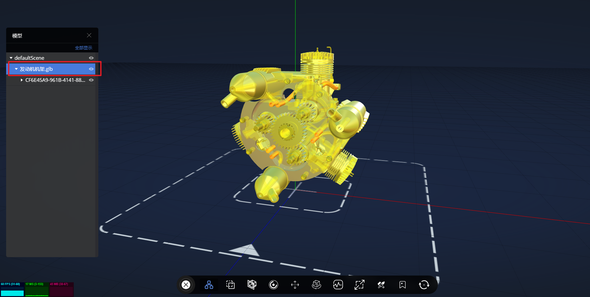  

9.标签：对设备三维场景中的零部件进行标记或注释，能够更好的管理三维场景中的对象。  
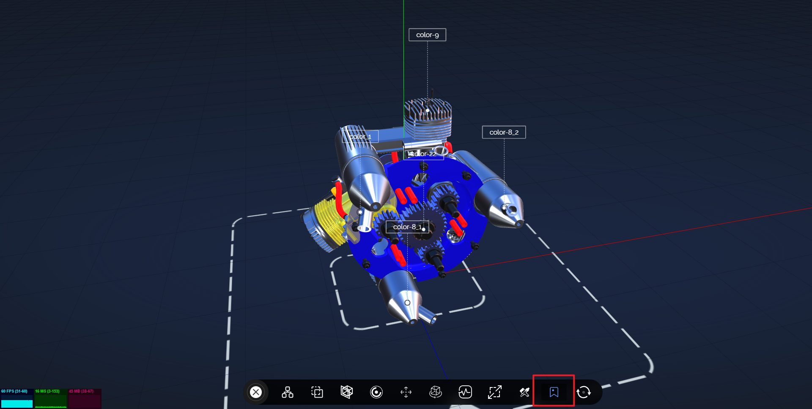  

10.重置：可以重新设置对象的状态和位置。在三维引擎中，如果一个对象的状态或位置发生了变化，可以通过重置来恢复其原始状态或位置。  
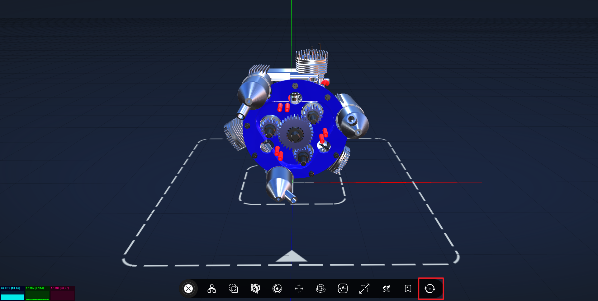 

 
#### 高级功能说明
1.分解设备功能
系统内的设备模型最高可达零件级，在运维过程中可根据实际需要，对设备零部件进行爆炸操作，方便查看设备内部结构。
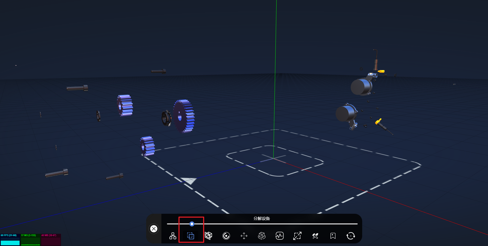  

2.剖切
该功能可对设备X、Y、Z向进行正向或反向的剖切操作，方便运维人员查看设备内部的逻辑结构，有助于出现运行故障时，快速、形象地理解故障点。
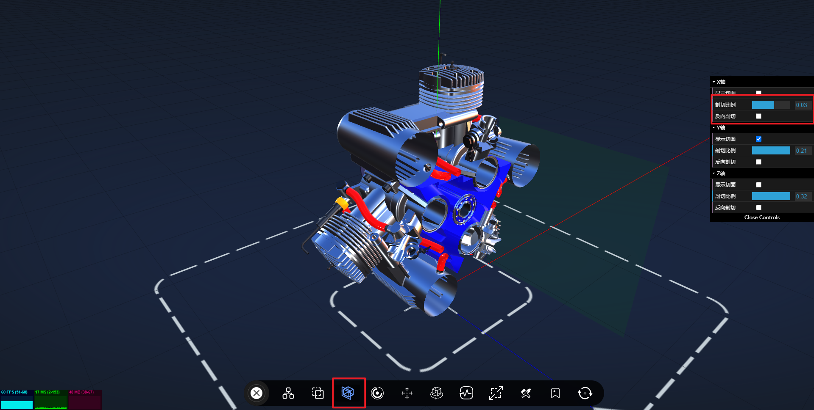  

3.测点
该功能可以反应设备的测点分布情况，包含温度、位移、转速、振动测点的分布，支持显示设备相关的实时测点数据，包含正常、警告和异常数据。
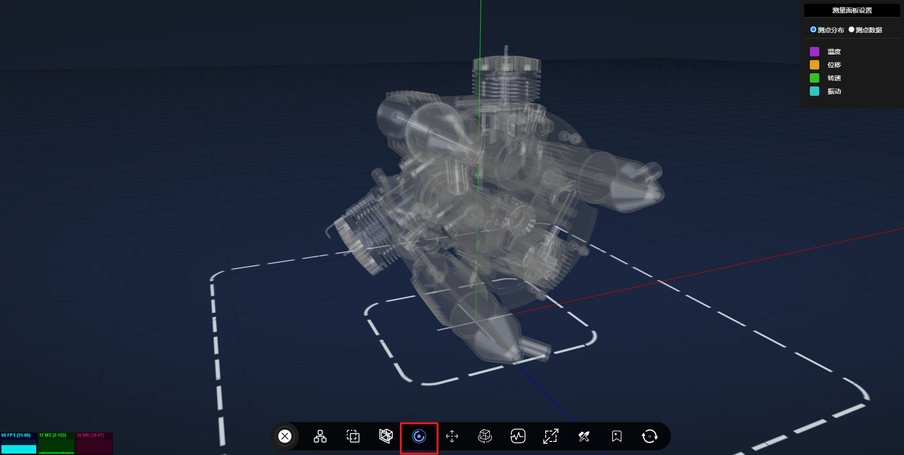  

4.健康度
该功能对场景中对象的状态和可用性进行度量，可以帮助运维人员更好地诊断和解决场景中的问题。在三维引擎中，健康度可以提供相关对象的信息，开发者可以使用这些信息解决场景中的问题，提高应用程序的可靠性和稳定性。
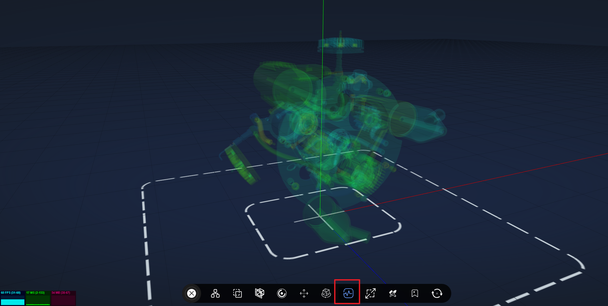  

5.材质功能
场景和材质都是针对不同的模型展示需求定制开发的，当用于培训时可以用默认效果，同时可以调节光效使三维物体的展示状态更佳，提高观赏性。
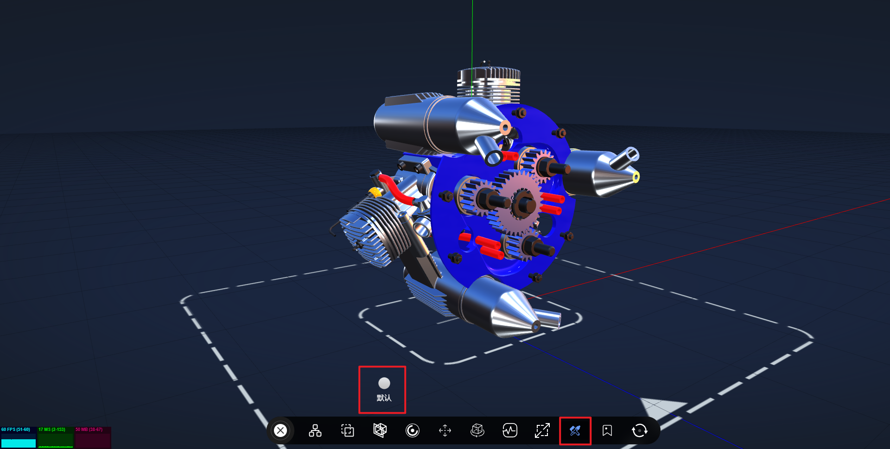

11. 部件聚焦功能
单击节点所在目录树行选中当前节点，三维模型中放大并对应模型部件，方便用户了解模型的构成和细节。
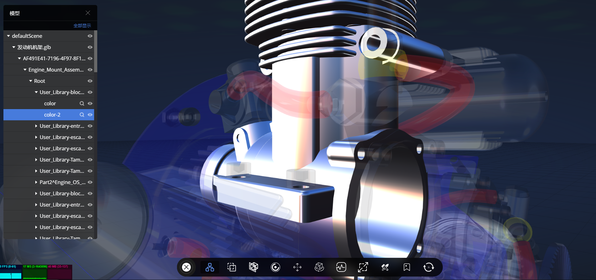

11. 仿真结果展示
支持paraview等仿真软件导出的结果文件或者多维数组等数据格式进行热力图等三维呈现。  
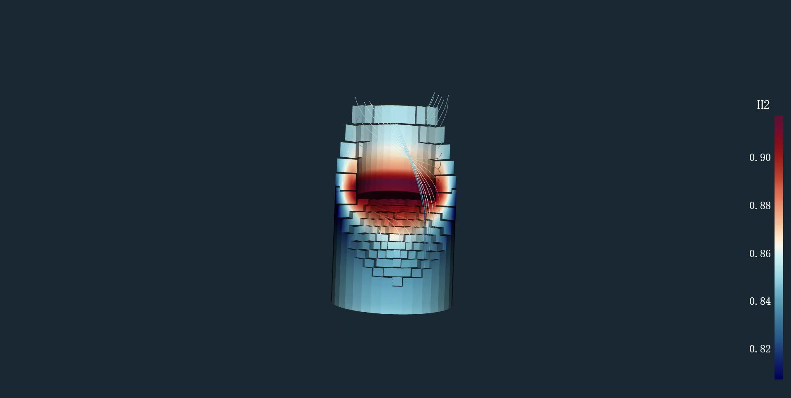

12. 动画动画
支持多种形式的动画，包括1.模型内置动画，2.自定义配置动画脚本，生成补间动画 3. 利用GLTF格式的动画片段。  

13. 漫游
针对园区类型的模型，支持配置路径进行三维沉浸式漫游。  

14. 多种渲染效果
支持多种渲染效果，内置线框模式（不是Three.js的线框模式，是外轮廓的线框), 简笔画模式， Xray模式等。   
简笔画模式是一种典型的风格化渲染方式，它可以将模型渲染成简洁、轮廓清晰的图案，适合于一些需要快速展示、说明模型的情境下使用。  
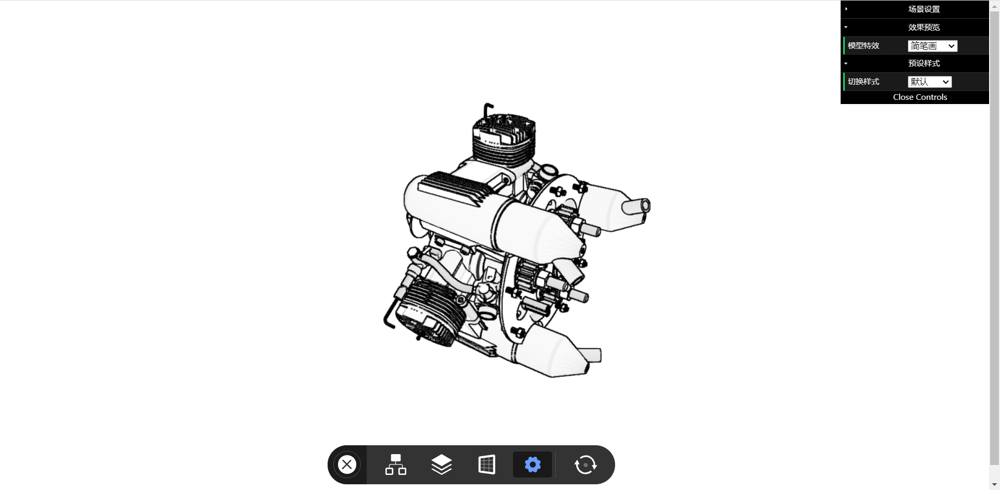  
XRay是一种透视渲染方式，通过透过模型的表面对其内部结构进行展示，适合于展示透明模型或分层结构。  

15. 粒子效果
支持采用面贴图方式实现气、水等效果。  

16. 模型本地缓存
支持模型首次下载后缓存在浏览器本地储存，以便于后续查看模型无需再次下载。  

### 代码版本
引擎将会提供两个版本，开源版提供模型加载、模型基础操作等功能用于学习交流
商业版包含以上所有基础和高级功能，也根据根据需要进行定制，并提供相应的技术支持。

### 代码本地运行
1.npm run install 下载相关依赖  
2.npm run dev 运行  
3.访问地址：localhost:9098
（Node版本：：12.0及以上）

### 联系方式
接受各类三维数字孪生项目，欢迎微信联系：  
   
加微信请标注“三维引擎”

